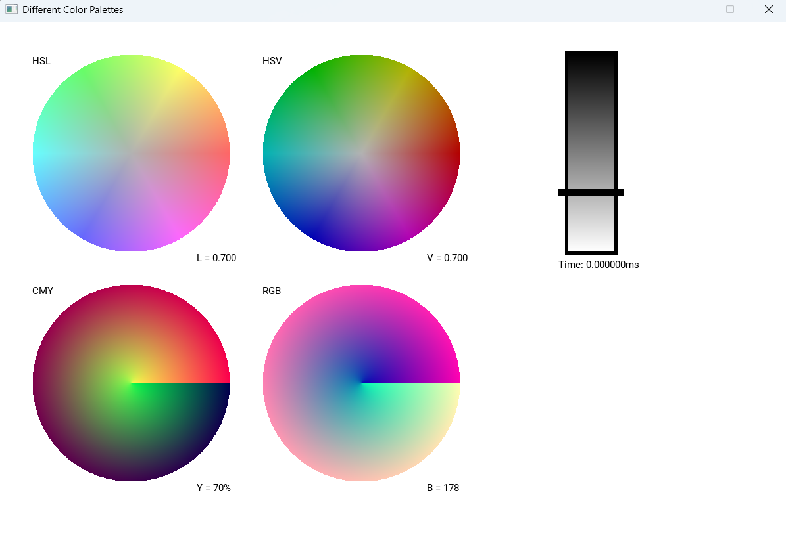

# Color Palettes

## Overview
The programme provides the user with color palettes in **4 different color formats** allowing the user change their Color projection using **custom-made** slider.

Programme supports:
- RGB 
- CMY
- HSV
- HSL

Slider lets the user to change every palettes **last channel** and see the results in ***real-time***.



## Setup
Before downloading make sure you have cmake installed. To run the programme, run commands:

```
git clone https://github.com/zagalahubert/ColorPalette.git
cd ColorPalette
cmake -B build -A x64
cmake --build build --config Release
cd build/Release
.\ColorPalettes.exe    
```

## Technologies
Technologies used:
1. C++
2. SFML
3. CMake
4. Roboto font (Apache 2.0)


